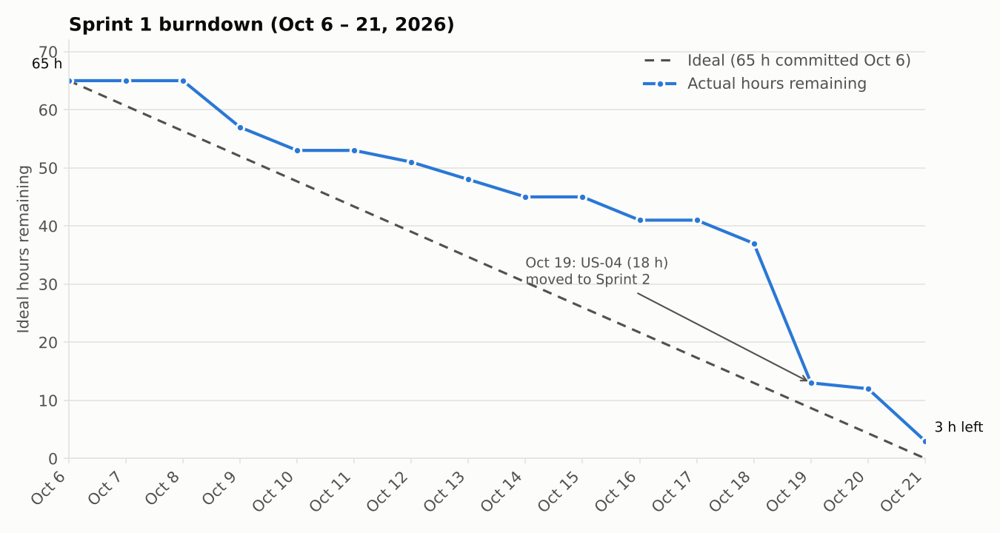

# Noted! (Team Hinton)

IST 303: Intro to Software Development, Fall 2026, Claremont Graduate University

Noted! is a Flask web app for writing music one note at a time. You start a piece, pick the key, time signature, and tempo, then add notes and rests, and the app draws it as sheet music. Pieces are saved to your account so you can come back to them later. More detail is in our [proposal](proposal/proposal.md).

## Team Members

| Initials | Name |
|---|---|
| DA | Daniel Abalusi |
| VS | Varuzhan Shahidzadeh |
| YX | Yalei Xu |
| BG | Beijia Gu |
| RM | Ryan Miller |

Daniel, Varuzhan, Yalei, and Beijia each have about 10 hours a week for this project. Ryan had about 5 hours a week in Part A and has had 10 since Oct 19.

## Project Schedule

| Part | Due | Points | What's due |
|---|---|---|---|
| A | Thu Oct 1, 2026 | 60 | GitHub repo with README: team members, user stories (estimates and acceptance criteria), tasks, who does what, iteration 1 plan |
| B | Thu Oct 22, 2026 (moved from Oct 15) | 80 | End of iteration 1: burndown chart, stand-up evidence, working code and tests, retrospective, iteration 2 plan |
| C | Thu Nov 12, 2026 (Week 10) | 180 | Milestone 1.0: class presentation with live demo and evidence of agile process; final codebase |

| Iteration | Dates | Length |
|---|---|---|
| Iteration 1 (Sprint 1) | Tue Oct 6 – Wed Oct 21, 2026 | 16 days |
| Iteration 2 (Sprint 2) | Thu Oct 22 – Wed Nov 11, 2026 | 3 weeks |
| Milestone 1.0 demo | Thu Nov 12, 2026 | |

---

# Part A

## 1. Concept

Our concept is in the [proposal](proposal/proposal.md). The short version: notation programs like Sibelius and Finale cost a lot and take time to learn, and the quick options (staff paper, voice memos, letter names typed into a notes app) are hard to edit or share. Noted! lets you enter music note by note and see it as sheet music. For **Milestone 1.0** we are sticking to a single treble-clef staff. Playback, PDF export, other clefs, sharing, audio transcription, and a practice mode are **stretch goals**.

## 2. Stakeholders

| Stakeholder | Why they matter to us |
|---|---|
| Music students | Main users. They need a simple way to write and keep notation exercises. |
| Hobbyists and songwriters | Main users. They want to get a melody down quickly and come back to it later. |
| Music teachers | Secondary users. Printing, sharing, and practice feedback (stretch goals) are mostly for them. |
| Course instructor | Our "customer." Sets the requirements and grades each part of the project. |
| Our team | We build it, and the plan has to fit our time: about 10 hours a week each (5 for Ryan in Part A, 10 from Oct 19). |
| Classmates | The audience for our Milestone 1.0 demo. |
| Library maintainers (Flask, music21, pytest, etc.) | We depend on their code, so changes or bugs on their end can affect us. |

## 3. User Stories

All stories and tasks are also on our [Jira board](https://teamhinton.atlassian.net/jira/software/projects/NTT/boards/1) (project NTT). In Jira, each task is a sub-task of its story, and the story point estimate is the same as the hour estimate here (1 point = 1 hour).

Estimates are in ideal hours, meaning focused work time. Each story's estimate is the total of its tasks in section 4. For priority, Must means it has to be in Milestone 1.0, Should means we will add it if there is time, and Stretch is a stretch goal.

### Summary

| ID | Jira | Story | Priority | Estimate (hrs) | Sprint |
|---|---|---|---|---|---|
| E-01 | [NTT-1](https://teamhinton.atlassian.net/browse/NTT-1) | Project foundation | Must | 16 | 1 |
| US-01 | [NTT-3](https://teamhinton.atlassian.net/browse/NTT-3) | Register an account | Must | 8 | 1 |
| US-02 | [NTT-4](https://teamhinton.atlassian.net/browse/NTT-4) | Log in and log out | Must | 9 | 1 |
| US-03 | [NTT-5](https://teamhinton.atlassian.net/browse/NTT-5) | Create a composition | Must | 10 | 1 |
| US-04 | [NTT-6](https://teamhinton.atlassian.net/browse/NTT-6) | Add notes one at a time | Must | 18 | 2 (moved from 1) |
| US-05 | [NTT-8](https://teamhinton.atlassian.net/browse/NTT-8) | Add rests | Must | 5 | 2 |
| SP-01 | [NTT-7](https://teamhinton.atlassian.net/browse/NTT-7) | Rendering spike | Must | 4 | 1 |
| US-06 | [NTT-9](https://teamhinton.atlassian.net/browse/NTT-9) | See the sheet music | Must | 17 (10 in Sprint 2) | 2 |
| US-10 | [NTT-10](https://teamhinton.atlassian.net/browse/NTT-10) | My Library: list and open | Must | 8 (4 in Sprint 2) | 2 |
| US-07 | [NTT-11](https://teamhinton.atlassian.net/browse/NTT-11) | Edit a note | Must | 8 | 2 |
| US-08 | [NTT-12](https://teamhinton.atlassian.net/browse/NTT-12) | Delete a note | Must | 5 | 2 |
| US-09 | [NTT-13](https://teamhinton.atlassian.net/browse/NTT-13) | Rename or delete a composition | Must | 7 | 2 (if time) |
| US-11 | [NTT-14](https://teamhinton.atlassian.net/browse/NTT-14) | Search my library | Should | 6 | 2 (if time) |
| US-12 | [NTT-15](https://teamhinton.atlassian.net/browse/NTT-15) | Keep my compositions private | Must | 6 (4 in Sprint 2) | 2 |
| US-13 | [NTT-16](https://teamhinton.atlassian.net/browse/NTT-16) | Play back my composition | Stretch | 14 | Backlog |
| US-14 | [NTT-17](https://teamhinton.atlassian.net/browse/NTT-17) | Export to PDF | Stretch | 10 | Backlog |
| US-15 | [NTT-18](https://teamhinton.atlassian.net/browse/NTT-18) | Use other clefs | Stretch | 14 | Backlog |
| US-16 | [NTT-19](https://teamhinton.atlassian.net/browse/NTT-19) | Share a composition | Stretch | 12 | Backlog |
| US-17 | [NTT-20](https://teamhinton.atlassian.net/browse/NTT-20) | Transcribe a recording | Stretch | 40 | Backlog |
| US-18 | [NTT-21](https://teamhinton.atlassian.net/browse/NTT-21) | Practice mode | Stretch | 36 | Backlog |

Total for all stories: 253 hours. Sprint columns reflect the plan as of Part B. The three re-estimates for Sprint 2 are explained in [section 10](#10-iteration-2-plan).

### Stories and acceptance criteria

#### E-01: Project foundation

As the development team, we want a working Flask skeleton, database, and test setup so that every feature story has a stable base to build on.

Priority: Must | Estimate: 16 hours

Acceptance criteria:

- [ ] Running `flask run` serves a home page with the shared layout.
- [ ] `flask init-db` creates the SQLite database with `User`, `Composition`, and `Note` tables.
- [ ] `pytest --cov` runs and reports coverage, with at least one passing test.
- [ ] The GitHub repo has a README and a protected `main` branch that requires a pull request, and the Jira board has all stories and tasks.

#### US-01: Register an account

As a new user, I want to create an account with a username, email, and password so that my compositions are saved under my name.

Priority: Must | Estimate: 8 hours

Acceptance criteria:

- [ ] Given a unique username and email and a password of 8+ characters, submitting the form creates the account and logs me in.
- [ ] A duplicate username or email shows an error and no account is created.
- [ ] Passwords are stored hashed, never in plain text.
- [ ] Missing or invalid fields show a message next to the field.

#### US-02: Log in and log out

As a registered user, I want to log in and out so that only I can reach my compositions.

Priority: Must | Estimate: 9 hours

Acceptance criteria:

- [ ] Correct credentials log me in and send me to My Library.
- [ ] Wrong credentials show "Invalid username or password" and do not log me in.
- [ ] Logging out ends the session and returns me to the home page.
- [ ] Visiting a protected page while logged out redirects to the login page.

#### US-03: Create a composition

As a songwriter, I want to start a new piece by choosing a title, key signature, time signature, and tempo so that my notes are written in the right musical context.

Priority: Must | Estimate: 10 hours

Acceptance criteria:

- [ ] The form offers all 15 major keys, time signatures 2/4, 3/4, 4/4, and 6/8, and a tempo from 40 to 240 BPM.
- [ ] Submitting a valid form creates a composition owned by me and opens it in the editor.
- [ ] A blank title or out-of-range tempo shows an error and nothing is saved.
- [ ] The editor shows the title, key, time signature, and tempo I chose.

#### US-04: Add notes one at a time

As a music student, I want to add notes by choosing pitch, octave, duration, and an accidental so that I can write out a melody.

Priority: Must | Estimate: 18 hours

Acceptance criteria:

- [ ] I can choose pitch A–G, an octave, a duration (whole, half, quarter, eighth, sixteenth), and sharp, flat, or natural.
- [ ] Clicking Add appends the note to the end of the piece and it stays after a page reload.
- [ ] Notes outside the treble-clef range (A3–C6) are rejected with a message.
- [ ] The piece converts to a valid music21 `Stream` with the notes in order.

#### US-05: Add rests

As a songwriter, I want to add rests of any duration so that my piece has the right rhythm.

Priority: Must | Estimate: 5 hours

Acceptance criteria:

- [ ] A Rest option is available for every duration.
- [ ] Rests are saved in order with notes and appear on the staff.
- [ ] Rests convert to music21 `Rest` objects.

#### SP-01: Rendering spike

As the development team, we want to test how to draw sheet music in Python before building US-06 so that we pick an approach that works and lower the risk to our Milestone 1.0 demo.

Priority: Must | Estimate: 4 hours

Acceptance criteria:

- [ ] We have tried music21 with an external renderer (LilyPond or MuseScore) and drawing our own SVG in Python.
- [ ] A prototype draws a treble staff with at least three notes as SVG from Python code.
- [ ] The chosen approach, its install steps, and why we chose it are written up in `docs/rendering-spike.md`.
- [ ] The approach runs on every team member's machine.

#### US-06: See the sheet music

As a user, I want my piece drawn as standard sheet music on a treble staff so that I can read and check what I wrote.

Priority: Must | Estimate: 17 hours

Acceptance criteria:

- [ ] The editor shows a five-line staff with a treble clef, key signature, and time signature.
- [ ] Each note sits on the correct line or space with the correct head, stem, and flag for its duration; accidentals are shown.
- [ ] Bar lines appear where each measure fills up for the chosen time signature.
- [ ] The staff updates right after a note or rest is added.
- [ ] The SVG is generated on the server in Python.

#### US-10: My Library: list and open

As a returning user, I want to see a list of my saved compositions and open one so that I can keep working on it.

Priority: Must | Estimate: 8 hours

Acceptance criteria:

- [ ] My Library lists only my compositions, newest edit first, with title, key, time signature, and last-edited date.
- [ ] Clicking a title opens it in the editor.
- [ ] With no compositions, the page shows "No compositions yet" and a New composition button.

#### US-07: Edit a note

As a user, I want to change a note's pitch, octave, duration, or accidental so that I can fix mistakes without re-entering the piece.

Priority: Must | Estimate: 8 hours

Acceptance criteria:

- [ ] Clicking a note on the staff (or in the note list) selects it and fills the palette with its values.
- [ ] Saving updates only that note; the staff redraws.
- [ ] Invalid values are rejected as in US-04.

#### US-08: Delete a note

As a user, I want to remove a note or rest so that I can clean up my piece.

Priority: Must | Estimate: 5 hours

Acceptance criteria:

- [ ] Deleting a note removes it and the remaining notes keep their order.
- [ ] The staff redraws without the note.

#### US-09: Rename or delete a composition

As a user, I want to rename a piece, change its settings, or delete it so that my library stays organized.

Priority: Must | Estimate: 7 hours

Acceptance criteria:

- [ ] I can change the title, key, time signature, and tempo; the staff redraws.
- [ ] Deleting asks for confirmation, then removes the composition and its notes.
- [ ] The deleted piece no longer appears in My Library.

#### US-11: Search my library

As a user with many pieces, I want to search my library by title so that I can find a piece quickly.

Priority: Should | Estimate: 6 hours

Acceptance criteria:

- [ ] Typing part of a title returns matching compositions, ignoring case.
- [ ] Only my compositions are searched.
- [ ] No matches shows "No compositions match".

#### US-12: Keep my compositions private

As a user, I want my compositions hidden from other users so that my work stays mine.

Priority: Must | Estimate: 6 hours

Acceptance criteria:

- [ ] Opening, editing, or deleting another user's composition by URL returns 404.
- [ ] Every composition and note route checks ownership.

#### US-13: Play back my composition

As a songwriter, I want to hear my piece played back so that I can check that it sounds right.

Priority: Stretch | Estimate: 14 hours

Acceptance criteria:

- [ ] A Play button plays the piece in the browser at the chosen tempo.
- [ ] Audio is generated in Python on the server.
- [ ] Audio is regenerated after the piece changes.

#### US-14: Export to PDF

As a music teacher, I want to download a piece as a PDF so that I can print it or hand it out.

Priority: Stretch | Estimate: 10 hours

Acceptance criteria:

- [ ] An Export PDF button downloads a PDF with the title and the full staff.
- [ ] The PDF matches what the editor shows.

#### US-15: Use other clefs

As a bass or viola player, I want to write in bass, alto, or tenor clef so that the music matches my instrument.

Priority: Stretch | Estimate: 14 hours

Acceptance criteria:

- [ ] I can choose treble, bass, alto, or tenor clef when creating or editing a piece.
- [ ] Notes are placed correctly for the chosen clef.
- [ ] The note range check follows the chosen clef.

#### US-16: Share a composition

As a user, I want to share a piece with another user so that they can view it.

Priority: Stretch | Estimate: 12 hours

Acceptance criteria:

- [ ] I can share a piece by entering another user's username.
- [ ] The other user sees it under "Shared with me" and can view it but not edit it.
- [ ] I can stop sharing at any time.

#### US-17: Transcribe a recording

As a musician, I want to upload a recording of a single instrument and get sheet music back so that I don't have to write it out by ear.

Priority: Stretch | Estimate: 40 hours

Acceptance criteria:

- [ ] I can upload a WAV or MP3 of one instrument (up to 60 seconds).
- [ ] The app creates a new composition with the detected notes and rhythms.
- [ ] On a clean test recording of a simple melody, at least 80% of pitches are correct.

#### US-18: Practice mode

As a music educator, I want to assign a piece and have the app compare a student's recording with it so that students get feedback on wrong notes and timing.

Priority: Stretch | Estimate: 36 hours

Acceptance criteria:

- [ ] An educator can assign a piece to a student.
- [ ] The student can upload a recording of themselves playing it and hear it back.
- [ ] The app highlights wrong notes and notes that are early or late.

## 4. Tasks

We split every story into tasks. Only iteration 1 tasks have owners for now. We will assign iteration 2 in Part B.

### E-01: Project foundation (16 hours)

| Task | Description | Est. (hrs) | Owner |
|---|---|---|---|
| E-01-T1 | Set up GitHub repo, branch protection, Jira board, README skeleton | 2 | VS |
| E-01-T2 | Create Flask app factory, config, and blueprints (auth, compositions, library) | 3 | DA |
| E-01-T3 | Define SQLAlchemy models `User`, `Composition`, `Note` and an `init-db` command | 5 | YX |
| E-01-T4 | Configure pytest + pytest-cov with fixtures (test client, in-memory DB, logged-in user) | 3 | YX |
| E-01-T5 | Build base Jinja layout: nav bar, flash messages, CSS | 3 | VS |

### US-01: Register an account (8 hours)

| Task | Description | Est. (hrs) | Owner |
|---|---|---|---|
| US-01-T1 | Registration form template | 2 | BG |
| US-01-T2 | Register route with validation (unique username/email, password rules) | 2 | BG |
| US-01-T3 | Hash passwords with Werkzeug and save the user | 1 | BG |
| US-01-T4 | Tests: success, duplicate user, bad input, password is hashed | 3 | RM |

### US-02: Log in and log out (9 hours)

| Task | Description | Est. (hrs) | Owner |
|---|---|---|---|
| US-02-T1 | Integrate Flask-Login and the user loader | 2 | DA |
| US-02-T2 | Login form and route with error message | 2 | DA |
| US-02-T3 | Logout route and nav bar that changes when logged in | 1 | DA |
| US-02-T4 | Apply `@login_required` to all composition and library routes | 1 | DA |
| US-02-T5 | Tests: good login, bad login, logout, protected-page redirect | 3 | BG |

### US-03: Create a composition (10 hours)

| Task | Description | Est. (hrs) | Owner |
|---|---|---|---|
| US-03-T1 | New-composition form (title, key, time signature, tempo) | 3 | TBD |
| US-03-T2 | Create route: validate and save the composition with the current user as owner | 2 | TBD |
| US-03-T3 | Composition editor page shell (header, staff area, note-entry area) | 3 | TBD |
| US-03-T4 | Tests: valid create, missing title, tempo out of range, owner is set | 2 | TBD |

### US-04: Add notes one at a time (18 hours)

| Task | Description | Est. (hrs) | Owner |
|---|---|---|---|
| US-04-T1 | Note ordering and storage logic (position index per composition) | 3 | TBD |
| US-04-T2 | Note-entry palette UI: pitch, octave, duration, accidental buttons | 5 | TBD |
| US-04-T3 | Add-note route that appends to the composition | 2 | TBD |
| US-04-T4 | Treble-clef range validation (A3–C6) | 2 | TBD |
| US-04-T5 | Service that converts a composition to a music21 Stream | 3 | TBD |
| US-04-T6 | Tests: add note, order kept, out-of-range rejected, music21 conversion | 3 | TBD |

### US-05: Add rests (5 hours)

| Task | Description | Est. (hrs) | Owner |
|---|---|---|---|
| US-05-T1 | Add Rest option to the note palette | 1 | TBD |
| US-05-T2 | Store rests (note with no pitch) in order | 1 | TBD |
| US-05-T3 | Handle rests in the music21 conversion and the renderer | 1 | TBD |
| US-05-T4 | Tests: add rest, rest in conversion, rest in rendered SVG | 2 | TBD |

### SP-01: Rendering spike (4 hours)

| Task | Description | Est. (hrs) | Owner |
|---|---|---|---|
| SP-01-T1 | Try music21 with LilyPond/MuseScore SVG export | 2 | VS |
| SP-01-T2 | Prototype a custom SVG staff with a few notes in Python | 1 | BG |
| SP-01-T3 | Write up the decision and install steps in docs/rendering-spike.md | 1 | VS |

### US-06: See the sheet music (17 hours)

| Task | Description | Est. (hrs) | Owner |
|---|---|---|---|
| US-06-T1 | Draw staff, treble clef, key signature, and time signature as SVG | 5 | TBD |
| US-06-T2 | Place notes: vertical position by pitch, heads/stems/flags by duration, accidentals | 6 | TBD |
| US-06-T3 | Insert bar lines based on time signature | 2 | TBD |
| US-06-T4 | Embed the SVG in the editor and refresh it after each change | 1 | TBD |
| US-06-T5 | Tests: SVG structure (line count, note positions, bar lines) | 3 | TBD |

### US-10: My Library: list and open (8 hours)

| Task | Description | Est. (hrs) | Owner |
|---|---|---|---|
| US-10-T1 | Library route: query the current user's compositions by last-modified | 2 | TBD |
| US-10-T2 | Library template (list with title, key, time signature, date) | 2 | TBD |
| US-10-T3 | Link each item to its editor | 1 | TBD |
| US-10-T4 | Empty-state message and button | 1 | TBD |
| US-10-T5 | Tests: lists only my pieces, sort order, empty state | 2 | TBD |

### US-07: Edit a note (8 hours)

| Task | Description | Est. (hrs) | Owner |
|---|---|---|---|
| US-07-T1 | Selectable notes in the editor | 2 | TBD |
| US-07-T2 | Edit form pre-filled with the note's values | 2 | TBD |
| US-07-T3 | Update route with validation | 2 | TBD |
| US-07-T4 | Tests | 2 | TBD |

### US-08: Delete a note (5 hours)

| Task | Description | Est. (hrs) | Owner |
|---|---|---|---|
| US-08-T1 | Delete control on the selected note | 1 | TBD |
| US-08-T2 | Delete route and re-index positions | 2 | TBD |
| US-08-T3 | Tests | 2 | TBD |

### US-09: Rename or delete a composition (7 hours)

| Task | Description | Est. (hrs) | Owner |
|---|---|---|---|
| US-09-T1 | Edit-settings form | 2 | TBD |
| US-09-T2 | Delete with confirmation; cascade-delete notes | 2 | TBD |
| US-09-T3 | Update and delete routes | 1 | TBD |
| US-09-T4 | Tests | 2 | TBD |

### US-11: Search my library (6 hours)

| Task | Description | Est. (hrs) | Owner |
|---|---|---|---|
| US-11-T1 | Search box on My Library | 1 | TBD |
| US-11-T2 | Case-insensitive title query scoped to the user | 2 | TBD |
| US-11-T3 | No-results message | 1 | TBD |
| US-11-T4 | Tests | 2 | TBD |

### US-12: Keep my compositions private (6 hours)

| Task | Description | Est. (hrs) | Owner |
|---|---|---|---|
| US-12-T1 | Ownership-check helper used on every composition route | 2 | TBD |
| US-12-T2 | Return 404 for non-owners | 1 | TBD |
| US-12-T3 | Tests: cross-user access attempts on every route | 3 | TBD |

### US-13: Play back my composition (14 hours)

| Task | Description | Est. (hrs) | Owner |
|---|---|---|---|
| US-13-T1 | Spike: generate audio in Python (music21 MIDI, simple synth to WAV) | 4 | TBD |
| US-13-T2 | Generate audio from the composition at its tempo | 4 | TBD |
| US-13-T3 | HTML audio player in the editor | 2 | TBD |
| US-13-T4 | Regenerate audio when the piece changes | 1 | TBD |
| US-13-T5 | Tests | 3 | TBD |

### US-14: Export to PDF (10 hours)

| Task | Description | Est. (hrs) | Owner |
|---|---|---|---|
| US-14-T1 | Choose SVG-to-PDF approach (e.g. CairoSVG or ReportLab) | 2 | TBD |
| US-14-T2 | Build the PDF with a title header and the staff | 4 | TBD |
| US-14-T3 | Download route | 1 | TBD |
| US-14-T4 | Tests | 3 | TBD |

### US-15: Use other clefs (14 hours)

| Task | Description | Est. (hrs) | Owner |
|---|---|---|---|
| US-15-T1 | Add a clef field to Composition | 2 | TBD |
| US-15-T2 | Clef selector on the forms | 1 | TBD |
| US-15-T3 | Draw bass, alto, and tenor clef symbols | 4 | TBD |
| US-15-T4 | Pitch-to-staff mapping per clef | 3 | TBD |
| US-15-T5 | Range validation per clef | 1 | TBD |
| US-15-T6 | Tests | 3 | TBD |

### US-16: Share a composition (12 hours)

| Task | Description | Est. (hrs) | Owner |
|---|---|---|---|
| US-16-T1 | Share model (composition, user, read-only) | 2 | TBD |
| US-16-T2 | Share form by username | 2 | TBD |
| US-16-T3 | "Shared with me" section | 3 | TBD |
| US-16-T4 | View-only permission checks | 2 | TBD |
| US-16-T5 | Tests | 3 | TBD |

### US-17: Transcribe a recording (40 hours)

| Task | Description | Est. (hrs) | Owner |
|---|---|---|---|
| US-17-T1 | Spike: pitch detection in Python (e.g. librosa pYIN) | 6 | TBD |
| US-17-T2 | Upload form and file validation | 3 | TBD |
| US-17-T3 | Onset detection and pitch tracking | 10 | TBD |
| US-17-T4 | Quantize durations to the tempo | 8 | TBD |
| US-17-T5 | Convert results into a new composition | 5 | TBD |
| US-17-T6 | Tests with sample recordings | 8 | TBD |

### US-18: Practice mode (36 hours)

| Task | Description | Est. (hrs) | Owner |
|---|---|---|---|
| US-18-T1 | Educator role and assignment model | 6 | TBD |
| US-18-T2 | Record/upload an attempt and play it back | 4 | TBD |
| US-18-T3 | Align the attempt with the written piece (uses US-17) | 12 | TBD |
| US-18-T4 | Feedback view highlighting wrong notes and timing | 8 | TBD |
| US-18-T5 | Tests | 6 | TBD |

## 5. Iteration 1 Plan

> This is the plan as submitted for Part A on Oct 1. After the Part B deadline moved to Oct 22, the plan changed; see [section 7](#7-what-changed-after-part-a) and [section 10](#10-iteration-2-plan).

Iteration 1 runs Oct 6 to Oct 14 (9 days) and ends at the Part B deadline. Iteration 2 runs Oct 15 to Nov 11 (4 weeks). We demo Milestone 1.0 on Nov 12.

### Velocity and capacity

| | |
|---|---|
| Team members | 5 |
| Hours per week | 10 each (Ryan: 5) = 45 total |
| Length of iteration 1 | 9 days (about 1.3 weeks) |
| Available hours (45 × 9/7) | 58 |
| Velocity (first iteration, no history yet) | 0.7 |
| Capacity (58 × 0.7) | 40 ideal hours |
| Planned for iteration 1 | 37 ideal hours |
| Buffer | 3 hours |

This is our first iteration, so we do not have a measured velocity yet. We are using 0.7, which assumes about 30% of our time goes to meetings, code reviews, setup issues, and learning Flask and music21. That gives us 40 hours of task work for the 9 days.

We first planned a two-week sprint starting Oct 1, but we started on Oct 6, which leaves 9 days before the Part B deadline. Our 6 planned stories came to 65 hours, so we kept the project setup (E-01), register (US-01), log in (US-02), and the rendering spike (SP-01), and moved create a composition (US-03) and add notes (US-04) to iteration 2. We kept SP-01 because US-06 (drawing the sheet music) is our riskiest story, and the spike lets us start it in iteration 2 with an approach we have already tested. That brings iteration 1 to 37 hours, with 3 hours of buffer. When iteration 1 is done, we will work out our actual velocity and use it to plan iteration 2.

### Stories in iteration 1

| ID | Story | Estimate (hrs) |
|---|---|---|
| E-01 | Project foundation | 16 |
| US-01 | Register an account | 8 |
| US-02 | Log in and log out | 9 |
| SP-01 | Rendering spike | 4 |
| | Total | 37 |

Goal for iteration 1: the project skeleton and tests are set up, a user can register and log in, and we have decided how we will draw the sheet music. That gives us working code and tests to show for Part B.

### Draft iteration 2 plan (we will revise this in Part B)

| ID | Story | Priority | Estimate (hrs) |
|---|---|---|---|
| US-03 | Create a composition | Must | 10 |
| US-04 | Add notes one at a time | Must | 18 |
| US-05 | Add rests | Must | 5 |
| US-06 | See the sheet music | Must | 17 |
| US-10 | My Library: list and open | Must | 8 |
| US-07 | Edit a note | Must | 8 |
| US-08 | Delete a note | Must | 5 |
| US-09 | Rename or delete a composition | Must | 7 |
| US-11 | Search my library | Should | 6 |
| US-12 | Keep my compositions private | Must | 6 |
| US-13 | Play back my composition | Stretch | 14 |
| US-14 | Export to PDF | Stretch | 10 |
| | Total | | 114 |

Iteration 2 is four weeks, so we have 180 hours, or 126 at a velocity of 0.7. This draft uses 114, which leaves about 12 hours for anything left over from iteration 1 and for getting the presentation ready. US-03, US-04, and US-06 come first because the demo depends on them. To make room for the stories moved from iteration 1, we moved two stretch stories, other clefs (US-15) and sharing (US-16), to the backlog. If we are slower than expected, playback (US-13) and PDF export (US-14) get cut next. US-15 through US-18 are saved for a possible Milestone 2.0.

## 6. Iteration 1 Task Allocation

With 40 hours of capacity, that comes to about 9 hours each for Daniel, Varuzhan, Yalei, and Beijia, and 4 for Ryan. Varuzhan took over the repo setup task (E-01-T1), but Daniel still has to change the repo settings because the repo is under his account.

| Member | Focus | Tasks | Total (hrs) |
|---|---|---|---|
| Daniel Abalusi (DA) | Flask skeleton, log in and log out | E-01-T2, US-02-T1, US-02-T2, US-02-T3, US-02-T4 | 9 |
| Varuzhan Shahidzadeh (VS) | Repo and Jira setup, base layout, rendering spike (music21 test, write-up) | E-01-T1, E-01-T5, SP-01-T1, SP-01-T3 | 8 |
| Yalei Xu (YX) | Database models, test setup | E-01-T3, E-01-T4 | 8 |
| Beijia Gu (BG) | Registration form and route, login tests, SVG staff prototype | US-01-T1, US-01-T2, US-01-T3, US-02-T5, SP-01-T2 | 9 |
| Ryan Miller (RM) | Registration tests | US-01-T4 | 3 |
| Total | | | 37 |

### Detailed allocation

**Daniel Abalusi (DA): 9 hours**

- E-01-T2: Create Flask app factory, config, and blueprints (auth, compositions, library) (3 hours)
- US-02-T1: Integrate Flask-Login and the user loader (2 hours)
- US-02-T2: Login form and route with error message (2 hours)
- US-02-T3: Logout route and nav bar that changes when logged in (1 hours)
- US-02-T4: Apply `@login_required` to all composition and library routes (1 hours)

**Varuzhan Shahidzadeh (VS): 8 hours**

- E-01-T1: Set up GitHub repo, branch protection, Jira board, README skeleton (2 hours)
- E-01-T5: Build base Jinja layout: nav bar, flash messages, CSS (3 hours)
- SP-01-T1: Try music21 with LilyPond/MuseScore SVG export (2 hours)
- SP-01-T3: Write up the decision and install steps in docs/rendering-spike.md (1 hours)

**Yalei Xu (YX): 8 hours**

- E-01-T3: Define SQLAlchemy models `User`, `Composition`, `Note` and an `init-db` command (5 hours)
- E-01-T4: Configure pytest + pytest-cov with fixtures (test client, in-memory DB, logged-in user) (3 hours)

**Beijia Gu (BG): 9 hours**

- US-01-T1: Registration form template (2 hours)
- US-01-T2: Register route with validation (unique username/email, password rules) (2 hours)
- US-01-T3: Hash passwords with Werkzeug and save the user (1 hours)
- US-02-T5: Tests: good login, bad login, logout, protected-page redirect (3 hours)
- SP-01-T2: Prototype a custom SVG staff with a few notes in Python (1 hours)

**Ryan Miller (RM): 3 hours**

- US-01-T4: Tests: success, duplicate user, bad input, password is hashed (3 hours)

### How we will work

- We meet once a week for a stand-up and keep notes in the `meetings/` folder. Between meetings we post updates in our group chat.
- Every story and task is tracked on our [Jira board](https://teamhinton.atlassian.net/jira/software/projects/NTT/boards/1). Stories are Jira stories, and tasks are sub-tasks with the owner and estimate.
- Everyone works on their own branch and opens a pull request. Someone else reviews it, and the tests have to pass before it gets merged into `main`.
- We track the hours left on each task so we can make the burndown chart for Part B.

---

# Part B

Part B covers iteration 1 (Sprint 1, Oct 6 – Oct 21) and our plan for iteration 2 (Sprint 2, Oct 22 – Nov 11). Everything here comes from our [Jira board](https://teamhinton.atlassian.net/jira/software/projects/NTT/boards/1) and the pull requests on GitHub.

## 7. What changed after Part A

Our Part A plan (section 5) was a 9-day iteration ending Oct 14 with 37 hours of work. Three things changed after that:

1. **The Part B deadline moved to Oct 22.** That gave us 16 days instead of 9, so we ran Sprint 1 until Oct 21 and pulled create a composition (US-03) and add notes (US-04) back in. Sprint 1 became 65 hours.
2. **We moved US-04 (18 hours) to Sprint 2 on Oct 19.** At our Friday check-in on Oct 16, login still wasn't merged, and US-03 and US-04 both depend on it. At the Oct 14 stand-up we had set that Friday as the check-in: if login wasn't in by then, the note-adding work would probably have to move. We waited until the login PR was merged on Oct 18 and then moved US-04 on Oct 19. That brought Sprint 1 to 47 hours.
3. **People moved between tasks.**
   - Ryan went from 5 to 10 hours a week (Oct 19).
   - Ryan took `@login_required` (NTT-33) and Varuzhan took the new-composition form (NTT-35) from Daniel, so the login and create-route work wasn't all on one person.
   - Varuzhan took the hand-drawn SVG prototype (NTT-46) from Beijia so she could focus on the register route.

Two smaller estimate changes: the logged-in test fixture was split out of the pytest setup task into its own task under US-02 (NTT-111, 1 hour), and the pytest setup task went from 3 to 2 hours. The total didn't change.

## 8. Iteration 1 Results

> **Final, Sprint 1 closed Oct 22.** 44 of 47 hours done. Two test tasks (3 hours) didn't start in time and carry over to Sprint 2: NTT-38 (create-route tests) and NTT-111 (logged-in test fixture). That leaves US-02 and US-03 one task short of Done.

### Stories

| ID | Story | Estimate (hrs) | Done (hrs) | Status |
|---|---|---|---|---|
| E-01 | Project foundation | 15 | 15 | ✅ Done |
| SP-01 | Rendering spike | 4 | 4 | ✅ Done (decision: music21 + Verovio, see [docs/rendering-spike.md](docs/rendering-spike.md)) |
| US-01 | Register an account | 8 | 8 | ✅ Done |
| US-02 | Log in and log out | 10 | 9 | 🔄 Login, logout, `@login_required` and login tests merged; logged-in fixture (NTT-111, 1 h) carries over |
| US-03 | Create a composition | 10 | 8 | 🔄 Form, create route and editor page merged; tests (NTT-38, 2 h) carry over |
| | **Total** | **47** | **44** | **94%** |
| US-04 | Add notes one at a time | 18 | – | ➡️ Moved to Sprint 2 on Oct 19 |

### Burndown



Hours remaining at the end of each day. A task's hours count as done on the day it was moved to Done in Jira, which is the day its PR was merged.

| Date | Oct 6 | 7 | 8 | 9 | 10 | 11 | 12 | 13 | 14 | 15 | 16 | 17 | 18 | 19 | 20 | 21 |
|---|---|---|---|---|---|---|---|---|---|---|---|---|---|---|---|---|
| Hours left | 65 | 65 | 65 | 57 | 53 | 53 | 51 | 48 | 45 | 45 | 41 | 41 | 37 | 13 | 12 | 3 |

What the chart shows:

- **Nothing was finished for the first three days.** Everyone was setting up: the repo, Jira, Python environments, and learning the PR workflow.
- **From Oct 9 to Oct 18 we finished about 3 hours a day,** but stayed well above the ideal line. Many tasks were coded but waited a few days for review or for another PR to merge first. For example, the base layout (NTT-25) was done on Oct 12 but wasn't merged until Oct 18.
- **The big drop on Oct 19 is mostly the scope change** (US-04 moving out), not 24 hours of work in one day.
- **Six hours merged on the last day** (the create route, login tests and `@login_required`). The line ends at 3 hours: the two test tasks that carry over.

### Velocity

| | |
|---|---|
| Hours available (45 h/week × 16 days, plus Ryan's extra 5 h/week from Oct 19) | about 105 |
| Velocity we planned with | 0.7 |
| Ideal hours finished | 44 |
| **Measured velocity** (44 ÷ 105) | **0.42** |

Our real velocity was a bit more than half of what we planned with. The estimates for individual tasks were mostly fine. What we didn't plan for was the time between "code done" and "merged": waiting for reviews, PRs that depended on other unmerged PRs, merge conflicts, and setup problems (virtual environments, Git logins).

### Working code and tests

Merged to `main` in Sprint 1:

- Flask app factory, config, blueprints, SQLite models (`User`, `Composition`, `Note`) and `flask init-db`
- Base layout with a nav bar that changes when you log in, flash messages, and shared CSS
- Register (with validation and hashed passwords), log in, and log out
- New-composition form (15 keys, 4 time signatures, tempo 40–240 with field errors) and the composition editor page
- pytest setup with shared fixtures; **110 tests passing on `main`**
- A GitHub Action that requests the Jira task's Reviewer on each new PR

To run it:

```bash
pip install -r requirements.txt
flask --app app init-db
flask --app app run
pytest --cov=. --cov-report=term
```

### Stand-up evidence

- **[Oct 6 kickoff](meetings/2026-10-06-standup.md):** first stand-up. We went over the plan, Jira and the PR workflow.
- **[Oct 14 stand-up](meetings/2026-10-14-standup.md):** mid-sprint stand-up, covering sprint status by person, the two blockers (login and the register route), the rendering spike results, and the sprint risk. The agenda spreadsheet we used is also in `meetings/`.
- **[Oct 21 end-of-sprint stand-up](meetings/2026-10-21-standup.md):** Sprint 1 review (44 of 47 hours done, two test tasks left), the rendering decision for US-04, the demo plan, and the retrospective questions. Recorded with Otter.ai; minutes written from the transcript.
- **[Sprint 1 team log](meetings/sprint-1-team-log.md):** between meetings we post updates in our group chat. This log lists the dated decisions from the chat.
- Jira comments on each task record handoffs and blockers. For example, NTT-28 and NTT-30 have the conflict between the two Flask-Login setups and how we resolved it.

## 9. Retrospective

> We asked three questions at the [Oct 21 stand-up](meetings/2026-10-21-standup.md): what went well, what didn't, and what to change. Each person's answers are in [meetings/sprint-1-retro-responses.md](meetings/sprint-1-retro-responses.md). This section combines them with what we saw in Jira and GitHub.

**What went well**

- **Teamwork and communication.** Everyone answered in the group chat, reviewers ran the tests themselves before approving, and urgent items got done quickly.
- **The PR workflow worked.** Every change went through a pull request with a reviewer and passing tests. We merged 16 PRs in Sprint 1, and `main` stayed working except for one short break (see below).
- **The spike paid off early.** We picked music21 + Verovio by Oct 16. That makes US-06 (drawing the sheet music) much smaller than planned. The original estimate assumed we would draw the staff ourselves.
- **People picked up each other's work** when someone was blocked or busy (NTT-33, NTT-35, NTT-46), and helped each other integrate features and track down issues through testing.
- **Tests came first in places.** Ryan wrote the register tests before the route existed, so they ran as soon as it merged.
- **Setting a check-in date in advance** (Friday Oct 16) made the US-04 decision quick, because we already knew what we would look at.

**What didn't go well**

- **Waiting on reviews and merges.** Some PRs went unreviewed and unmerged for days. The base layout (NTT-25) was done on Oct 12 and merged on Oct 18. Several PRs were waiting on it.
- **Dependencies between tasks weren't clear.** Branches were built on other unmerged branches, which caused merge conflicts and overlapping work, and it got worse as the sprint went on. Two people set up Flask-Login separately (NTT-28 and NTT-30), and someone had to reconcile them. Reviewers also found it confusing to test a feature that depended on unfinished work.
- **Too much of the critical path was on one person** (login, create route, reviews) at a busy time for them.
- **One merge broke `main`.** PR #14 was merged before a follow-up fix was pushed, so two editor tests failed on `main` until PR #15 merged.
- **Setup friction:** virtual environments, Git and SourceTree logins, and Dropbox syncing `.venv` cost several hours across the team.

**What we'll change in Sprint 2**

Four of the five of us independently named the same two problems: unclear dependencies between tasks, and PRs waiting too long for review. Changes 1 and 2 address them.

1. **Review within 24 hours.** If you're requested as a reviewer, review or say you can't within a day so someone else can.
2. **Make dependencies visible.** Link dependent tasks in Jira ("blocks / is blocked by"). Every PR says what it depends on and gives step-by-step testing instructions. Branch from `main`, not from someone else's open branch. If you need unmerged work, say so in the PR and agree on the merge order first.
3. **Run tests automatically on every PR** with a GitHub Action, so nothing that breaks `main` can merge.
4. **Plan with the velocity we measured (0.42), not 0.7.**
5. **Spread the critical path:** no one person owns every task that blocks others.

## 10. Iteration 2 Plan

Sprint 2 runs **Oct 22 – Nov 11 (3 weeks)**, and we demo Milestone 1.0 on **Nov 12**.

### Capacity

| | |
|---|---|
| Team hours per week | 50 (10 each; Ryan is now at 10) |
| Hours available (50 × 3 weeks) | 150 |
| Velocity | 0.42 (measured in Sprint 1, see section 8) |
| **Capacity** | **about 63 ideal hours** |

### Stories

Thanks to the rendering spike and work already merged, three stories are smaller than their Part A estimates:

- **US-06 drops from 17 to 10 hours.** Verovio draws the staff, notes and bar lines, so we no longer write that ourselves.
- **US-10 drops from 8 to 4 hours.** The library list exists, and the link to the editor is part of PR #15.
- **US-12 drops from 6 to 4 hours.** The editor already returns 404 for other users' pieces.

| ID | Story | Priority | Estimate (hrs) | |
|---|---|---|---|---|
| — | Carried over from Sprint 1 (NTT-38, NTT-111) | Must | 3 | finishes US-02 and US-03 |
| US-04 | Add notes one at a time | Must | 18 | moved from Sprint 1 |
| US-06 | See the sheet music | Must | 10 | was 17 |
| US-05 | Add rests | Must | 5 | |
| US-10 | My Library: list and open | Must | 4 | was 8 |
| US-07 | Edit a note | Must | 8 | |
| US-08 | Delete a note | Must | 5 | |
| US-12 | Keep my compositions private | Must | 4 | was 6 |
| — | Demo and presentation prep | | 4 | |
| | **Committed** | | **61** | |
| US-09 | Rename or delete a composition | Must | 7 | first in line if we're ahead |
| US-11 | Search my library | Should | 6 | if time allows |
| US-13, US-14 | Playback, PDF export | Stretch | 24 | moved to the backlog |

US-09 is a Must in Part A, but it doesn't fit at our real velocity once US-04 and carry-over are in. It's the first story we'll pull in if we finish early. The demo still works without it: you can create, write, see, edit and reopen a piece.

**Order:** US-04 first, then US-06 (both are needed for the demo), then US-05, US-07, US-08, US-10, US-12.

**Sprint 2 goal:** a user can write a piece note by note, see it as real sheet music, fix mistakes, and reopen it from their library, with every page private to its owner.

### Task allocation (proposed; to confirm at Sprint 2 planning)

| Member | Tasks | Hours | + carry-over |
|---|---|---|---|
| Varuzhan (VS) | US-04-T2 note palette UI (5), US-06-T3 show the SVG in the editor and refresh it (1), US-06-T4 empty-piece placeholder (1), US-07-T1 selectable notes (2), US-07-T2 edit form (2), US-10-T4 empty-library message (1) | 12 | – |
| Beijia (BG) | US-04-T5 composition → music21 Stream (3), US-04-T6 tests (3), US-06-T1 Verovio render service (3), US-05-T3 rests in conversion (1) | 10 | – |
| Yalei (YX) | US-04-T1 note ordering and storage (3), US-04-T3 add-note route (2), US-05-T1/T2 rest option and storage (2), US-07-T3 update route (2), US-08-T2 delete route and re-index (2) | 11 | NTT-111 (1) |
| Daniel (DA) | US-06-T2 map Verovio note IDs to notes (2), US-07-T4 tests (2), US-08-T1 delete control (1), US-10-T1 sort by last modified (1), US-10-T5 tests (2), US-12-T1 ownership helper on every route (2) | 10 | – |
| Ryan (RM) | US-04-T4 range validation A3–C6 (2), US-05-T4 tests (2), US-06-T5 SVG tests (3), US-08-T3 tests (2), US-12-T3 cross-user tests (2) | 11 | NTT-38 (2) |
| **Total** | | **54** | **3** |

The rewritten US-06 tasks for the Verovio approach replace the original ones in section 4:

| Task | Description | Hours |
|---|---|---|
| US-06-T1 | Render service: composition → music21 Stream → MusicXML → Verovio SVG | 3 |
| US-06-T2 | Map each Verovio note element to its `Note.id` so notes can be selected | 2 |
| US-06-T3 | Show the SVG in the editor and refresh it after each change | 1 |
| US-06-T4 | Placeholder staff for a piece with no notes | 1 |
| US-06-T5 | Tests: one SVG note element per note, rests, key and time signature | 3 |
